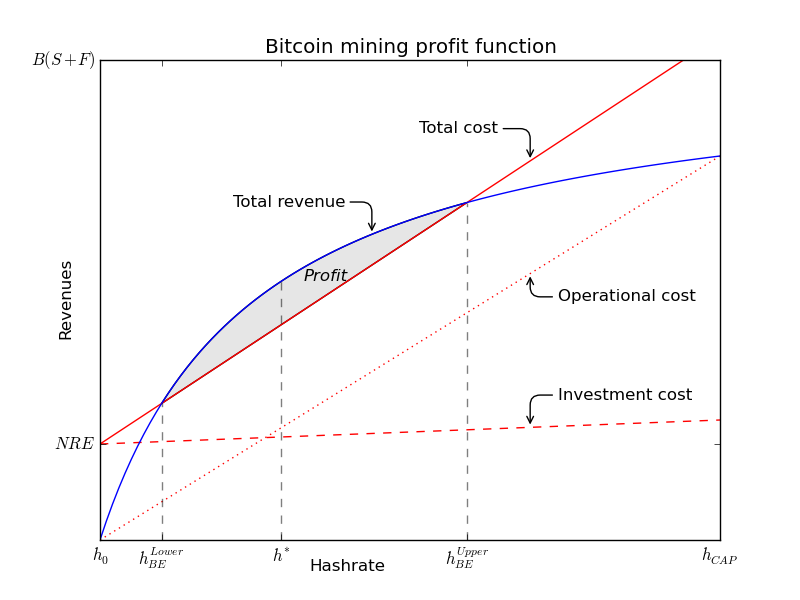

# Overview

This repository contains the code used to model Bitcoin mining profitability as described in "Minting Money With Megawatts", an article which appeared as a cover feature of the Proceedings of the IEEE | Vol. 104, No. 9, September 2016. 

# Requirements

Python 3.11+ and [uv](https://docs.astral.sh/uv/). Install with `uv sync`, run tests with `uv run pytest`, and regenerate the reference plot with `uv run python plotReference.py`.

# Where to start?

Start with the notebook MiningProfitability.ipynb at:

https://github.com/sweyn/bitcoin-mining-profitability/blob/main/MiningProfitability.ipynb

If GitHub's notebook renderer shows an error, open it in Google Colab:

# Model update (October 2026)

BTC price, network hashrate, fees and hardware cost were refreshed to October 2026: BTC at $83.4K, hashrate at 985 EH/s, fees at 2.58 BTC/day and hardware at $18.38/TH. The other inputs keep their May 2026 values. The optimum h\* (986 EH/s) now sits just above h₀, but the margin it earns does not cover the fixed NRE charge, so no new capacity is profitable at a 3-year amortization (T_Implied = 3.18 years). **The zero-profit network size R/D is 987 EH/s, 0.2% above the observed network.** At the low end of the hashrate sources (950 EH/s), new capacity turns profitable. See [docs/october-2026-update.md](docs/october-2026-update.md).

# Model review (May 2026)

All reference parameters were refreshed to May 2026 market and industry data. With May 2026 inputs — BTC at $78K, network hashrate at 960 EH/s, Bitmain S21 XP hardware at 13.5 J/TH, competitive electricity at $0.055/kWh, PUE 1.10, and 95% utilization — the model puts the zero-profit network size (R/D) at 933 EH/s, 2.9% below the observed 960 EH/s. The gap is smaller than the spread in the inputs (sources put h₀ at 935–994 EH/s). The data are consistent with competitive equilibrium but too uncertain to test it precisely. No new capacity is profitable at a 3-year amortization; breakeven needs 3.41 years (T_Implied).

The model's functional form and core insight have held up well over a decade. Its principal limitation is that it is static and deterministic — it gives a point-in-time answer in a market where BTC price, fees, and hashrate are highly volatile. At current conditions h\* and h₀ are within 1.4% of each other, meaning small changes in any input flip the profitability conclusion. A probabilistic extension (e.g. Monte Carlo over price and hashrate scenarios) would be the most valuable next step.

A code review following the parameter refresh found and fixed nine bugs: closed-form threshold formulas in the notebook were missing the UTZ utilization factor (5.3% error at UTZ=0.95), the notebook's reference tables still showed 2016 parameters, a stale PUE row in the extrema check produced wrong derived values, and the Python script had a transposed print statement and redundant computations. None of the fixes alter the model's numerical outputs. See [docs/claude-review.md](docs/claude-review.md) for the full findings table.

# Documentation

- [docs/open-questions.md](docs/open-questions.md) — Profitability of new vs. existing capacity and model updates to explore (October 2026)
- [docs/october-2026-update.md](docs/october-2026-update.md) — October 2026 refresh of BTC price, hashrate, fees and hardware cost, with sources and sensitivity to hashrate
- [docs/claude-review.md](docs/claude-review.md) — Full model review following May 2026 parameter refresh, including code review findings and fix log
- [docs/market-data-update-summary.md](docs/market-data-update-summary.md) — Summary of all parameter changes from 2016 to May 2026 values, with sources
- [docs/extrema-check.md](docs/extrema-check.md) — Analytical derivation of h\*, h_CAP, and h_BE with numerical cross-check against the code

# Administrative

Content provided under a Creative Commons Attribution-NonCommercial-ShareAlike (CC BY-NC-SA) (c)2013-2026. 

# Acknowledgements

Thanks to Agust Valfells, Sigurdur Johannesson and Stephen Harrington. Plots made with [Matplotlib](http://matplotlib.org).
